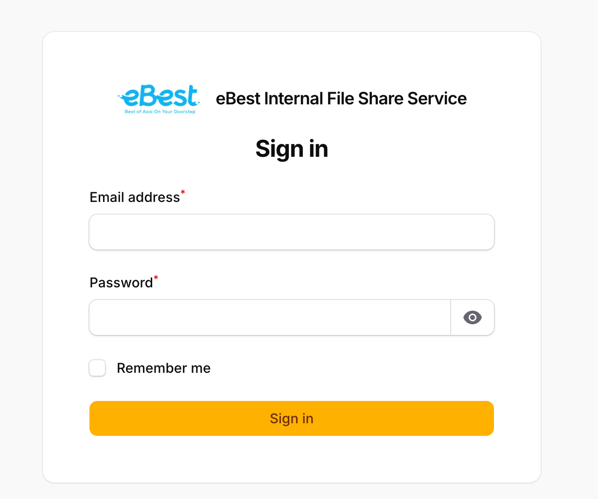
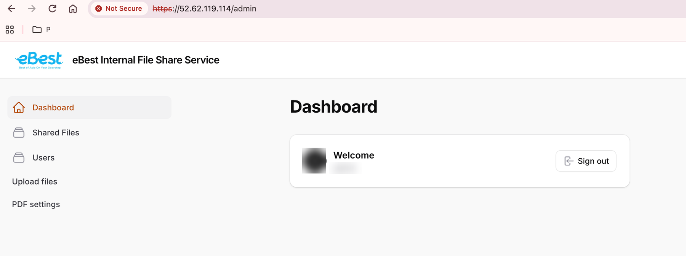
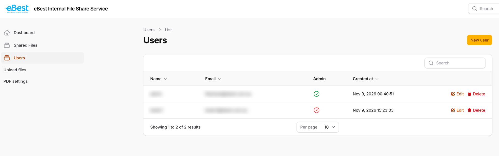
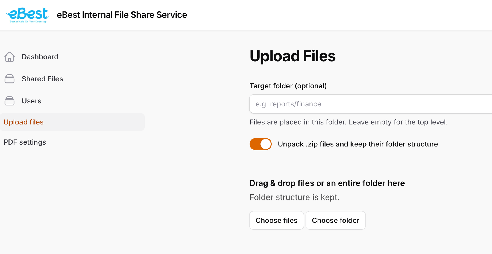
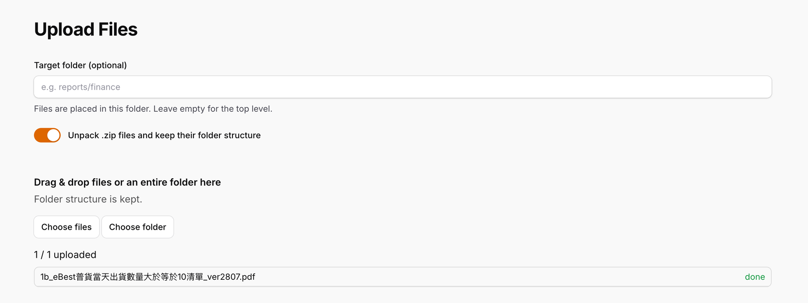
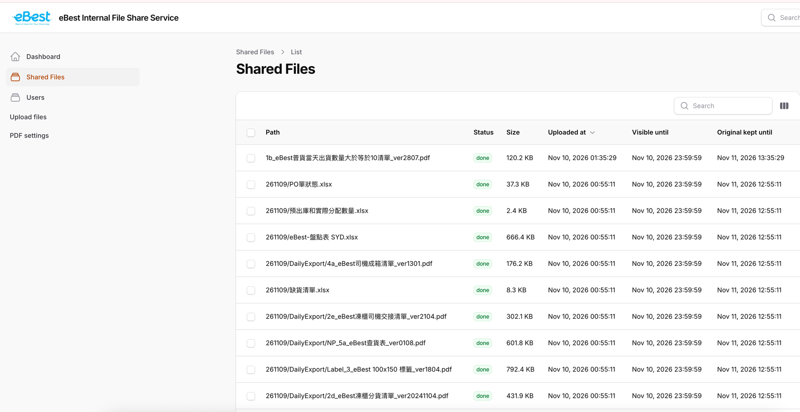
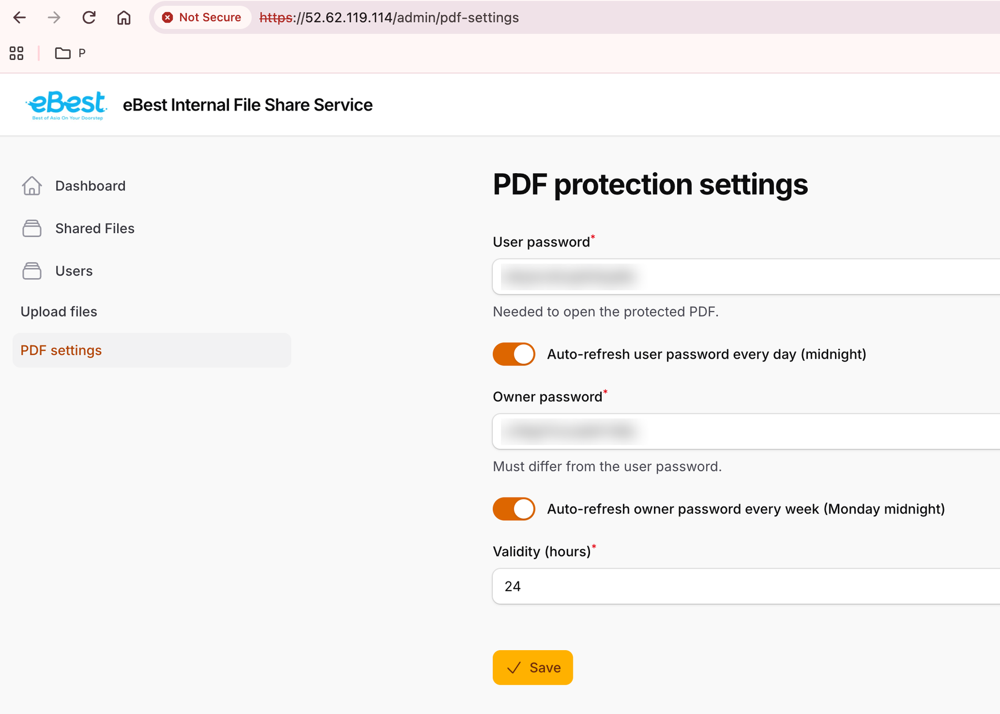

# Fileshare 管理员指南

本指南面向管理员,介绍如何登录系统、管理用户、上传文件和设置 PDF 参数。所有操作都在网页界面中完成。

## 1. 登录

1. 用浏览器打开 `https://52.62.119.114/admin/`。
2. 输入邮箱和密码,点击 **Sign in**。登录页默认勾选 **Remember me**,浏览器会记住登录状态和账号信息,下次访问无需再次输入;在公共电脑上请取消勾选,并在使用后点击 **Sign out**。
3. 登录后进入管理后台。左侧菜单从上到下依次是:**Dashboard**(首页)、**Shared Files**(已共享文件)、**Users**(用户管理)、**Upload files**(上传文件)、**PDF settings**(PDF 参数设置)。

系统有三种用户角色:

| 角色 | 权限 |
| --- | --- |
| Administrator(管理员) | 用户管理、上传文件、查看已共享文件、PDF 参数设置 |
| Operator(操作员) | 上传文件、查看已共享文件;没有用户管理和 PDF 参数设置 |
| Normal user(普通用户) | 只能下载文件,不能登录管理后台 |

管理员和操作员可以登录此页面;操作员的左侧菜单只显示 **Shared Files** 和 **Upload files**。普通用户请使用 `https://52.62.119.114/app`。

## 2. 用户管理

只有管理员可以管理用户。点击左侧菜单的 **Users**,可以看到所有账号的姓名、邮箱、角色和创建时间。

**新建用户**

1. 点击右上角的 **New user**。
2. 填写 **Name**(姓名)、**Email**(邮箱,用于登录)和 **Password**(密码,至少 8 位)。
3. 在 **Role**(角色)下拉框中选择:**Administrator**(管理员)、**Operator**(操作员)或 **Normal user**(普通用户)。
4. 点击 **Create** 保存。
5. 把邮箱和密码告知用户,用户从 `https://52.62.119.114/app` 登录。

**修改用户**

1. 在列表中点击该用户行的 **Edit**。
2. 修改姓名、邮箱或角色。需要重置密码时,在 **Password** 中输入新密码;留空则保持原密码。
3. 点击 **Save changes**。

**删除用户**:点击该用户行的 **Delete**,在弹出的确认框中确认。

## 3. 上传文件

点击左侧菜单的 **Upload files**。

1. (可选)在 **Target folder** 中填写目标文件夹,例如 `reports/finance`,上传的内容会放到这个文件夹下;留空则放在最上层。
2. (可选)**Unpack .zip files and keep their folder structure** 开关:打开时,zip 文件会被自动解压,并保留其中的文件夹结构;关闭时,zip 作为一个文件保存。
3. 把文件或整个文件夹拖到虚线框中,或点击 **Choose files**(选择文件)/ **Choose folder**(选择文件夹)。
4. 下方列表会显示每个文件的状态:queued(排队)、uploading(上传中)、done(完成)、failed(失败),并显示已完成的数量。全部完成前请不要关闭页面。

说明:

- 拖入整个文件夹时,文件夹结构会保留,用户在下载页面看到的文件夹与上传时一致。
- 空文件夹不会保留,因为只有文件才会被上传。
- 用相同路径再次上传同一个文件,会覆盖原来的文件。
- 上传后,PDF 文件会自动加密处理,其他文件原样发布。处理完成后用户即可看到并下载。
- 文件当天有效,到当天午夜(悉尼时间)后用户列表中将不再显示。

**查看处理结果**:点击左侧菜单的 **Shared files**,可以看到每个文件的状态(pending 等待、processing 处理中、done 完成、failed 失败)、大小和可见截止时间。状态为 failed 的文件,可以点击该行的 **Retry** 重新处理。

## 4. PDF 参数设置

点击左侧菜单的 **PDF settings**。每个上传的 PDF 都会按这里的设置自动加密。修改后点击 **Save** 保存。

| 参数 | 默认值 | 说明 |
| --- | --- | --- |
| User password(用户密码) | 系统随机生成 | 打开 PDF 所需的密码。用户在下载页面顶部可以看到当前密码。 |
| Owner password(所有者密码) | 系统随机生成 | 管理用密码,必须与用户密码不同。在 Adobe 中用它打开 PDF 时不受有效期限制。 |
| Validity (hours)(有效小时数) | 24 | 从 PDF 处理完成起,在 Adobe Acrobat/Reader 中可以打开的小时数。 |

**自动更换**

- 用户密码默认每天更换一次(每天午夜,悉尼时间)。
- 所有者密码默认每周更换一次(每周一午夜)。
- 页面上每个密码下方有自动更换开关(Auto-refresh)。手动修改并保存密码后,该密码的自动更换会被关闭,密码保持不变,直到您再次修改;重新打开开关即可恢复自动更换。

**重要提示**:新设置只对之后处理的 PDF 生效。已经处理过的 PDF 仍使用当时的密码,而用户页面显示的始终是当前的用户密码。修改密码后,如需让旧文件使用新密码,请重新上传这些文件。

**修改记录**:页面下方的 **Change history** 表格记录了三项参数的每次修改,包括时间、项目、旧值、新值和操作人(自动更换显示为 auto)。密码以明文显示,方便您查看。
