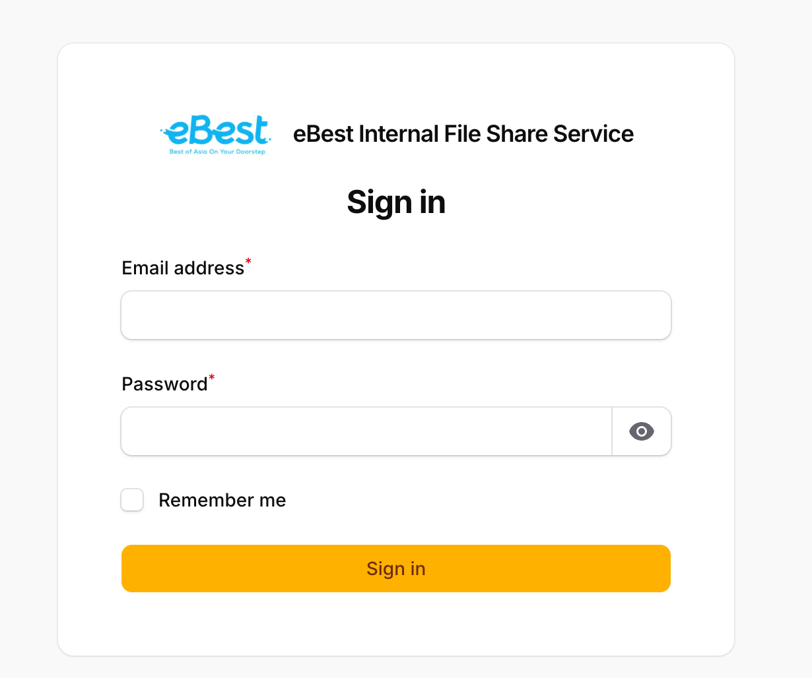
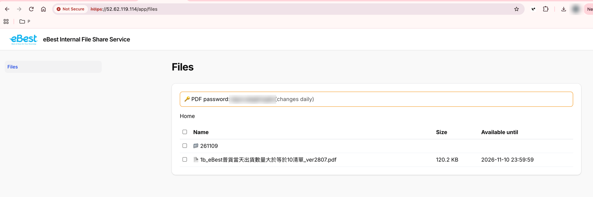
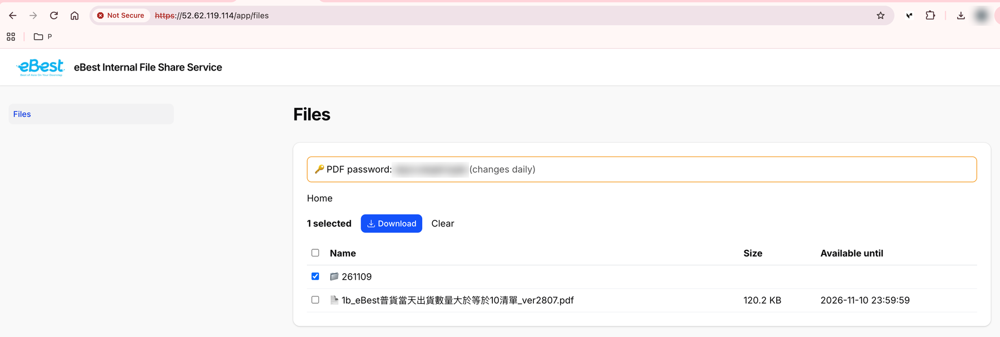
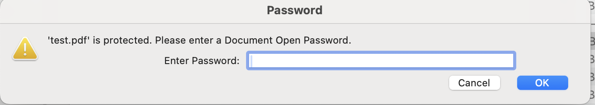
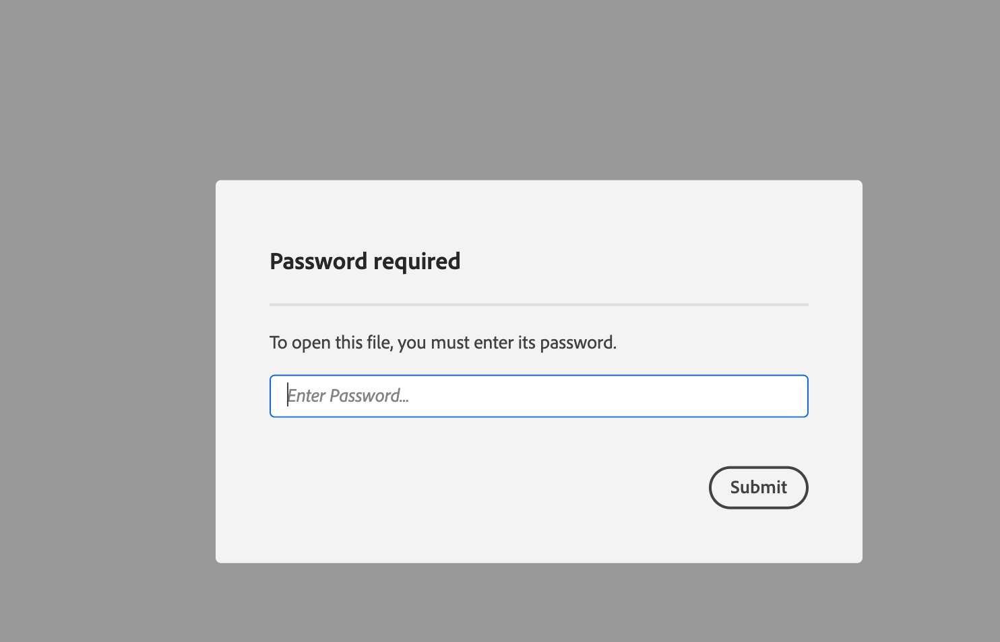
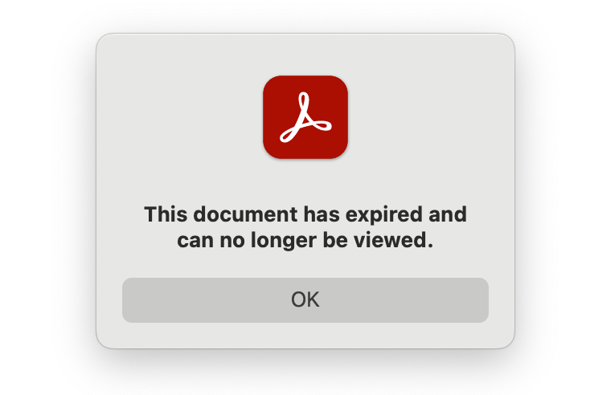

# Fileshare 用户指南

本指南面向普通用户,介绍如何登录、下载文件、打开带密码的 PDF,以及有效期的注意事项。

## 1. 登录

1. 用浏览器打开 `https://52.62.119.114/app`。
2. 输入您的邮箱和密码,点击 **Sign in**。账号由管理员提供,如没有账号或忘记密码,请联系管理员。登录页默认勾选 **Remember me**,浏览器会记住您的登录状态,下次访问无需再次输入;在公共电脑上请取消勾选,并在使用后退出登录。
3. 登录后进入 **Files**(文件)页面。页面顶部的黄色框里显示今天的 **PDF password**(PDF 密码),下面是文件夹和文件列表。

## 2. 下载文件

**浏览文件夹**

- 点击文件夹名称进入该文件夹,可以看到里面的子文件夹和文件。
- 点击页面上方路径中的 Home 或任一文件夹名称,可以返回上一级。

**下载单个文件**:直接点击文件名即可下载。

**下载多个文件、整个文件夹,或文件和文件夹混合下载**

1. 勾选需要的文件或文件夹前面的方框。点击表头的方框可以选中当前文件夹中的全部内容,再点一次取消。
2. 切换到其他文件夹后,已勾选的内容仍会保留,所以可以跨文件夹选择。
3. 列表上方会显示已选数量。点击 **Download** 开始下载;点击 **Clear** 清除所有选择。

下载结果:

| 您的选择 | 下载内容 |
| --- | --- |
| 单个文件 | 该文件本身 |
| 多个文件 | 一个 zip 压缩包 |
| 一个文件夹 | 一个以文件夹命名的 zip 压缩包,里面保留子文件夹和文件 |
| 文件夹和文件混合 | 一个 zip 压缩包,选中的文件夹保持原有结构 |

## 3. 打开带密码的 PDF

PDF 文件带有密码保护。

1. 在 **Files** 页面顶部的黄色框中找到 **PDF password**(PDF 密码)。
2. 下载 PDF 后用 Adobe Acrobat 或 Adobe Reader 打开,在弹出的密码框中输入该密码。
3. PDF 只能查看和打印,不能复制或编辑内容。

注意:PDF 密码每天午夜(悉尼时间)更换一次,请使用您下载当天页面上显示的密码。

## 4. 有效期说明

- **文件有效期**:页面上每个文件的 **Available until** 列显示该文件可下载的截止时间,通常是当天午夜(悉尼时间)。过期后文件会从列表中消失,请及时下载。
- **PDF 有效期**:每个 PDF 都有使用期限,默认为 24 小时(从文件处理完成时算起)。在 Adobe Acrobat/Reader 中,超过期限后 PDF 将无法打开,并显示 "This document has expired and can no longer be viewed."(文档已过期,无法再查看)的提示。
- 部分其他查看器(例如浏览器)可能不会执行有效期限制,但这不代表文件长期有效。请不要依赖这一点,用完后请删除不再需要的文件副本。
- 如文件已过期或需要重新获取,请联系管理员。

