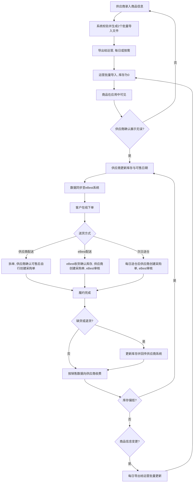
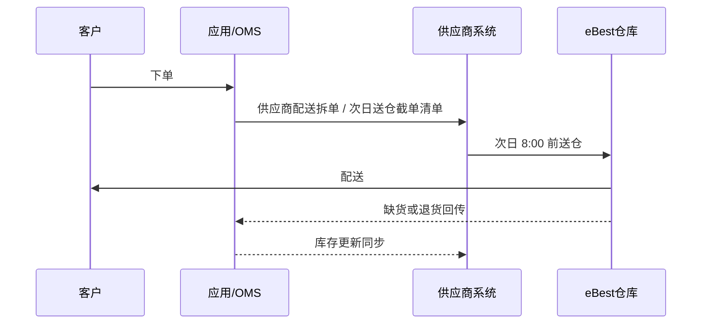
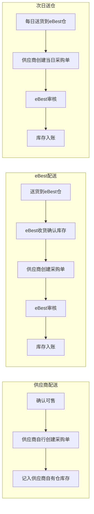
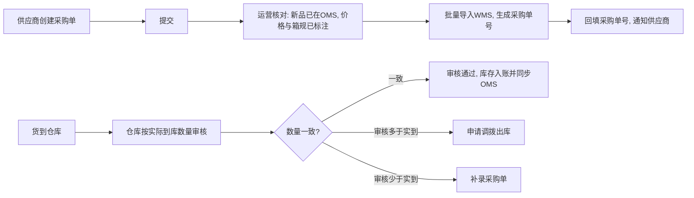
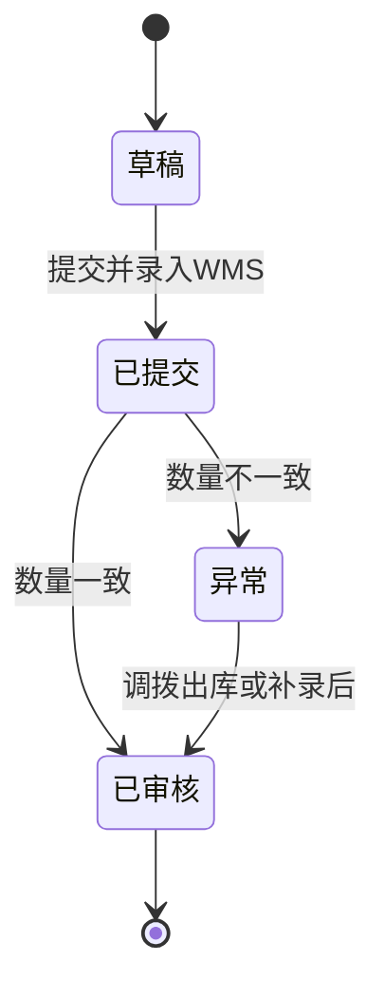
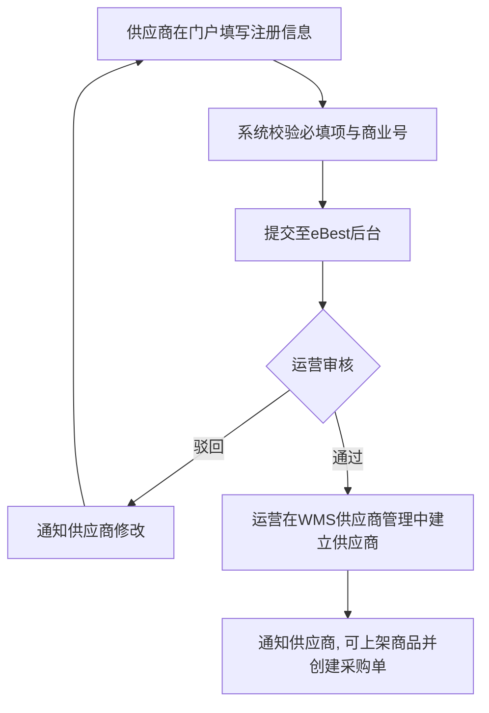
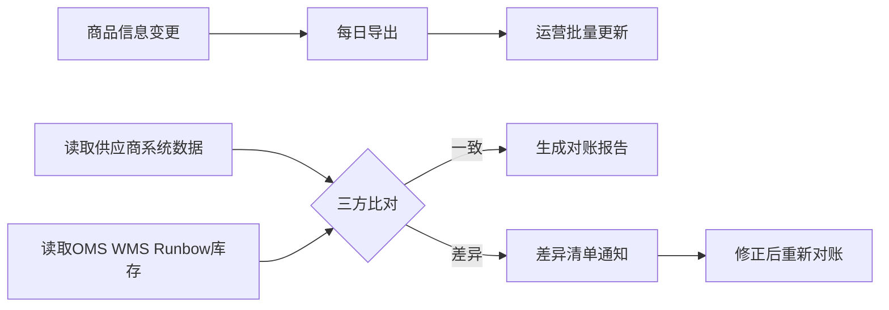
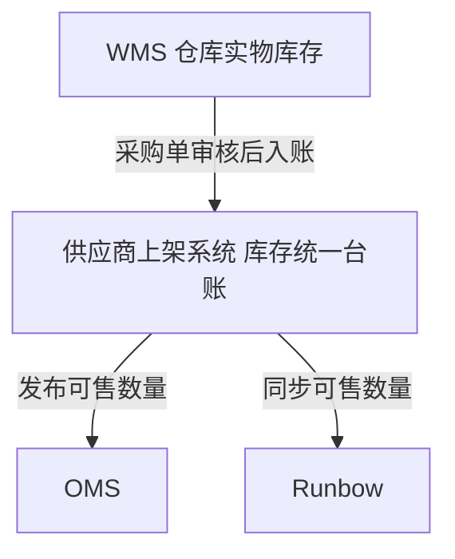

# eBest 供应商商品上架系统需求规格说明书

| 项目 | 内容 |
|---|---|
| 版本 | v0.4 草案(根据评审意见修订) |
| 日期 | 2026-11-14 |
| 状态 | 待评审 |
| 输入资料 | 原始需求(见 onboarding 目录下的需求原文)、批量导入表格模板、订单管理系统库表结构、样例数据、图片规格截图 |

**本版修订摘要**
- 新增"库存统一标准"(第 4.4 节、图 10):针对供应商上架系统内的库存,明确三套库存(OMS、WMS、Runbow)的口径与数据责任。
- 新增"采购单管理"(第 4.5 节、图 5 至图 7):明确三种送货方式下采购单由谁创建、何时创建、是否需要 eBest 审核,解决"送货后须在 WMS 录入采购单库存才增加"的问题。
- 依据"PO录入流程与审核"文档,梳理 eBest 现有采购单流程(第 3.5 节),新系统的采购单与之对齐,不另建单据体系。
- 采购单增加完整字段(依据采购单模板)、校验规则和异常处理(第 4.5 节),状态改为与现有流程一致。
- 新增供应商注册(第 3.7 节、第 4.8 节),内容参照新供应商表。
- 全文为纯中文描述。

---

## 1. 背景与目标

### 1.1 背景
目前供应商的商品信息、库存、送货安排主要依靠人工沟通,eBest 运营团队需手工整理后录入系统。流程耗时、易出错,商品数据在供应商与 eBest 之间容易不一致。此外,eBest 内部同时存在 OMS、WMS、Runbow 三套库存,送货到仓后还需在 WMS 录入采购单库存才会增加,造成库存口径不一、入账滞后。

### 1.2 目标
1. 提供独立的供应商上架界面,由供应商自行录入商品资料。
2. 自动生成符合 eBest 批量导入格式的两个表格文件,供运营每日或按需批量上传。
3. 覆盖"上架、入仓、可售、订单履约、退货缺货、结算"的完整闭环。
4. 建立供应商库存的统一标准,并通过采购单驱动库存入账。
5. 每周自动对账,保证供应商系统与 eBest 各系统数据一致。

### 1.3 范围
**范围内**:供应商上架门户、表格导出、状态跟踪、采购单管理、供应商注册、供应商库存标准与同步、订单与截单清单推送、对账、结算数据汇总。

**范围外(本期)**:eBest 前台应用改造、eBest 内部系统改造、支付与实际财务结算(仅提供结算数据)、eBest 自采商品的库存管理。

### 1.4 术语
| 术语 | 说明 |
|---|---|
| 供应商 | 入驻 eBest 的商品供应方 |
| 运营 | eBest 运营人员,负责批量导入 |
| OMS | eBest 订单管理系统(库表结构见订单管理系统库表文件) |
| WMS | eBest 仓库管理系统,记录仓库实物库存,采购单审核后库存增加 |
| Runbow | eBest 现有第三套库存系统(具体职责待确认) |
| 采购单 | 供应商向 eBest 申报送货入库的单据,用于驱动库存入账 |
| 供应商配送 | 供应商自行把商品送给客户 |
| eBest 配送 | 供应商把商品送到 eBest 仓库备货,由 eBest 配送 |
| 次日送仓 | 供应商不在 eBest 仓库备货,按截单清单在次日早上 8:00 前送到 eBest 仓库 |

---

## 2. 角色

| 角色 | 职责 |
|---|---|
| 供应商 | 注册、录入商品、确认展示效果、维护库存与可售日期、创建采购单、组织送货 |
| eBest 运营 | 审核供应商注册、获取导出文件、批量导入、录入采购单、维护商品信息变更 |
| eBest 仓库 | 收货并确认库存、按实际到库数量审核采购单、按供应商分拣发货 |
| 系统管理员 | 供应商账号、权限、对账配置 |

---

## 3. 总体业务流程

### 3.1 端到端流程

### 3.2 商品状态流转

对应原始需求的三个状态:**已上架**、**已入仓**(供应商自有仓库或 eBest 仓库均可)、**可售**(商品在应用中可见)。

### 3.3 配送与订单履约时序

### 3.4 采购单创建与审核流程

三种送货方式的采购单规则不同:

| 送货方式 | 采购单创建时机 | 创建人 | eBest 审核 | 库存入账 |
|---|---|---|---|---|
| 供应商配送 | 供应商确认商品可售后 | 供应商自行创建 | 不需要 | 记入供应商自有仓库存 |
| eBest 配送 | eBest 收货并确认库存后 | 供应商创建 | 需要(仓库人员按实际到库数量审核) | 审核通过后记入 eBest 仓库存(WMS) |
| 次日送仓 | 每天送货到 eBest 仓库后 | 供应商创建当日采购单 | 需要(仓库人员按实际到库数量审核) | 审核通过后记入 eBest 仓库存(WMS) |

### 3.5 与现有采购单流程的衔接

**现有流程概述**(依据"PO录入流程与审核"文档):

1. 采购与供货商下单后,把采购单(PO)交给录入人员,采购单须包含:供货商正式名称、采购日期、采购人、营销模式(自营、寄售、平台)、预计到货时间、产品信息(产品名、商品编码或条形码、数量、含税单价)、是否同步库存。
2. 录入人员在 WMS 中录入:选择是否同步库存(即库存推送到 OMS)、供货商、采购日期、采购人员,参考号填发票号(无发票号时按"年月日加两位序号"编写,如 2026111501),并选择营销模式(选错将搜索不到产品)。可逐条新建,也可批量导入(系统可导出模板)。
3. 录入时通过商品编码或条形码定位产品,填入含税单价与数量,免税商品勾选免税;核对数量与金额后提交,系统自动生成采购单号。
4. 货到仓库后,仓库人员**严格按实际到库数量**审核:审核数量大于实际到货时,须申请调拨出库,并在采购支付单申请时附调拨出库单;审核数量小于实际到货时,须补录采购单,并与原采购单一起提交支付单申请。
5. 货已到库但无采购单时,仓库须当天联系采购补录,下班前确认采购单已录入、货物可审核。
6. 所有入库产品(含蔬菜水果等生鲜)都必须录入采购单;特品与生鲜须在到货当天录完并审核完。
7. 新品须先在 OMS 创建后才能录入采购单;新供货商须先在 WMS 中建立供货商(需权限),再录入采购单。
8. 价格与箱规须标注:本次价格与上次不同时标注;发票为箱规、需拆开上架的,标注箱规规格与单价;虚拟库存商品统一录入数量 999999、单价 0 元,无例外。
9. 录入完毕后须在协作看板登记供货商、预计到货时间、产品总数量(采购已备注"已登记"的除外)。

**衔接原则**:新系统生成的采购单,字段、规则与上述现有流程一致;不另建一套单据体系;采购单号、审核和库存入账仍以 WMS 为准。接口就绪前,运营使用新系统导出的批量导入文件把采购单录入 WMS,并将采购单号回填新系统。

### 3.6 采购单状态

状态由现有流程中的"采购单状态查询"和"异常采购单列表"两处菜单归纳,最终以 WMS 实际状态为准(见待决问题 Q9)。

### 3.7 新供应商注册流程

### 3.8 变更与对账流程

---

## 4. 功能需求

### 4.1 供应商上架界面

独立于 eBest 后台,供应商通过账号登录,支持单条录入与表格批量导入草稿。

| 编号 | 需求 |
|---|---|
| FR-1.1 | 供应商账号登录,只能看到自己的商品 |
| FR-1.2 | 录入商品:中英文标题、描述、商品编码、上架数量、期望送货方式 |
| FR-1.3 | 上传图片:封面(750×750,必填)、左上角标签图/商标(100×100,可选)、分享海报图(宽 375、高度自适应、最大高 466,可选)、产品主图(750:750,必填)、详情视频(可选)、产品详情图(宽 375、高度自适应,必填) |
| FR-1.4 | 补齐批量导入所需全部字段(见第 5 章),必填项缺失不可提交 |
| FR-1.5 | 草稿保存、提交、被退回后修改并重新提交 |
| FR-1.6 | 图片格式与尺寸校验,上传后生成可访问地址 |
| FR-1.7 | 查看商品当前状态与状态历史 |

### 4.2 数据导出

| 编号 | 需求 |
|---|---|
| FR-2.1 | 导出为**两个独立表格文件**,分别对应通用商品导入模板和食品上架模板 |
| FR-2.2 | 每日定时导出(时间可配置),运营也可手动触发 |
| FR-2.3 | 导出范围为新提交商品和信息变更商品,按批次编号标记,避免重复 |
| FR-2.4 | 运营可下载历史批次,并回填导入结果(成功或失败原因) |
| FR-2.5 | 导出的列、顺序、枚举值必须与模板完全一致 |

### 4.3 送货与状态更新

| 编号 | 需求 |
|---|---|
| FR-3.1 | 支持三种送货方式:供应商配送(同一订单拆成两个派送单)、eBest 配送、次日送仓 |
| FR-3.2 | 次日送仓:每日 23:30 截单后供应商收到清单,次日 8:00 前送到 eBest 仓库,并按客户和标签分拣 |
| FR-3.3 | 供应商安排送仓并更新送货状态(已发货、已送达),仓库确认收货 |
| FR-3.4 | 商品状态:已上架、已入仓、可售 |
| FR-3.5 | 截单清单可在线查看与下载,次日送仓超时未送达时提醒 |

### 4.4 库存统一标准(新增)

**适用范围**:仅针对供应商上架系统内的供应商商品库存,不包含 eBest 自采商品。

**背景**:库存目前分布在 OMS、WMS、Runbow 三个系统,需要统一的口径与数据责任,避免同一商品在不同系统数量不一致。

以下标准为建议方案,待与相关系统负责人确认:

| 编号 | 需求 |
|---|---|
| FR-4.1 | 每个商品编码的库存统一按三类数量记录:**在途数量**(已创建采购单、尚未入账)、**入仓数量**(采购单入账后)、**可售数量**(供应商确认后对外发布) |
| FR-4.2 | **数据责任**:供应商自有仓库存以供应商上架系统为准;eBest 仓库存以 WMS 为准,且只能经采购单审核后增加;可售数量由供应商上架系统统一发布,同步至 OMS 与 Runbow |
| FR-4.3 | 每次库存变动必须有单据来源(采购单、订单、退货、缺货、手工调整)并保留变动记录 |
| FR-4.4 | 供应商更新库存与可售日期后,数据同步至 eBest 系统;同步接口须可重复调用而不产生重复入账 |
| FR-4.5 | 缺货或退货导致的库存变化由 eBest 回传供应商系统 |
| FR-4.6 | 库存低于阈值时提醒供应商补货 |
| FR-4.7 | 每周对供应商上架系统、OMS、WMS、Runbow 四方库存做对账,差异以责任系统为准修正并留痕(见 4.6) |

### 4.5 采购单管理(新增)

采购单须与 eBest 现有采购单流程一致(见 3.5)。

**业务规则**

| 编号 | 需求 |
|---|---|
| FR-5.1 | **供应商配送**:供应商确认商品可售后,由供应商自行创建采购单,无需 eBest 审核,库存记入供应商自有仓 |
| FR-5.2 | **eBest 配送**:eBest 收货并确认库存后,由供应商创建采购单,由仓库人员按实际到库数量审核;审核通过后库存增加 |
| FR-5.3 | **次日送仓**:每天送货到 eBest 仓库后,供应商创建当日采购单,由仓库人员按实际到库数量审核;审核通过后库存增加 |
| FR-5.4 | 采购单状态:草稿、已提交、已审核、异常,与 WMS 状态一一对应,以 WMS 为准 |
| FR-5.5 | 采购单号由 WMS 在提交后自动生成;新系统保存草稿编号,并在回填后建立与 WMS 采购单号的关联,同一采购单只保留一份 |
| FR-5.6 | 建议功能:次日送仓采购单可根据当日截单清单和实际送货数量自动预填,供应商核对后提交 |
| FR-5.7 | 采购单只能包含已在 OMS 创建(状态为已上架)的商品,未导入的新品不得出现在采购单中 |
| FR-5.8 | 采购单与库存变动记录一一关联,可追溯 |

**采购单表头字段**(依据采购单模板)

| 字段 | 说明 |
|---|---|
| 供货商名称 | 发票上的正式公司名称,来自已注册的供应商 |
| 采购日期 | 采购单日期 |
| 采购人 | 本系统中为供应商联系人;eBest 内部录入时对应采购人员 |
| 营销模式 | 自营、寄售、平台三选一;选错将无法定位产品,须与商品的营销模式一致 |
| 预计到货时间 | 预计送达 eBest 仓库的日期 |
| 是否同步库存 | 选是则库存推送到 OMS,默认值待确认(Q10) |
| 参考号 | 发票号;无发票号时按"年月日加两位序号"自动编写 |

**采购单明细字段**

| 字段 | 说明 |
|---|---|
| 产品名称 | 来自商品资料 |
| 商品编码 | 与条形码至少填一个,用于准确定位产品 |
| 条形码 | 同上 |
| 数量 | 整数,大于 0 |
| 含税单价 | 含商品服务税的单价 |
| 税率 | 免税商品须标记为免税 |
| 小计 | 数量乘以含税单价,系统自动计算 |
| 价格变动标注 | 本次单价与上次采购单不同时,系统提示并要求标注 |
| 箱规说明 | 需要拆箱上架的,须填写箱规规格与单价 |

采购单底部显示总额,提交前须核对数量与金额。

**校验与规则**

| 编号 | 需求 |
|---|---|
| FR-5.9 | 表头七项和明细必填项缺失时不可提交 |
| FR-5.10 | 虚拟库存商品统一录入数量 999999、单价 0 元,无例外,由系统自动带出,不可修改 |
| FR-5.11 | 同一供应商、同一商品,本次单价与上一次不同时,系统比对并提示 |
| FR-5.12 | 次日送仓、生鲜与特品:采购单须在到货当天提交,逾期未提交时提醒供应商和运营 |
| FR-5.13 | 货已到仓库但无采购单时,提醒供应商当天补建,在仓库下班前完成 |

**审核与异常**

| 编号 | 需求 |
|---|---|
| FR-5.14 | 仓库人员按实际到库数量审核;审核结果与到库数量回传新系统,数量一致时库存入账并同步 OMS |
| FR-5.15 | 审核数量大于实际到货:新系统记录异常,关联调拨出库单,供后续支付单申请使用 |
| FR-5.16 | 审核数量小于实际到货:新系统支持补录采购单并关联原采购单,两张单一起用于支付单申请 |
| FR-5.17 | 异常采购单有独立列表,可按供应商、日期、状态筛选 |

**与现有流程对齐**

| 编号 | 需求 |
|---|---|
| FR-5.18 | 采购单字段、规则、状态与现有流程一致,新系统不得引入冲突的字段或状态 |
| FR-5.19 | 审核与入账只在现有流程中完成,新系统不提供绕过审核的入账途径 |
| FR-5.20 | 过渡方式:新系统导出符合 WMS 批量导入模板的采购单文件,运营导入后把采购单号回填;接口就绪后改为自动传递 |
| FR-5.21 | 采购单录入后在协作看板登记供货商、预计到货时间、产品总数量的工作,由新系统在导出文件中提供这三项汇总,供运营登记(是否仍需登记待确认,见 Q11) |

### 4.6 每周对账

| 编号 | 需求 |
|---|---|
| FR-6.1 | 每周自动比对供应商上架系统与 OMS 数据库的商品数据(标题、价格、商品编码、状态) |
| FR-6.2 | 库存按 FR-4.7 与 WMS、Runbow 一并对账 |
| FR-6.3 | 生成差异报告,通知运营与供应商,支持标记已处理 |
| FR-6.4 | 保留对账历史 |

### 4.7 订单与结算

| 编号 | 需求 |
|---|---|
| FR-7.1 | 订单分流:供应商配送单、eBest 配送单、次日送仓单 |
| FR-7.2 | 基于销售数据统计应收费用(覆盖平台、仓储、配送成本),费率可配置 |
| FR-7.3 | 供应商可查看结算明细(本期仅提供数据,不含支付) |

### 4.8 供应商注册(新增)

新供应商须先注册并经 eBest 建立供货商资料后,才能上架商品和创建采购单。供应商在门户填写注册信息,信息发送到 eBest 后台,内容参照"新供应商表"。

| 编号 | 需求 |
|---|---|
| FR-8.1 | 申请类型:新建供应商或修改已有供应商 |
| FR-8.2 | **供应商信息**:澳大利亚商业号(11 位数字,格式校验)、供应商名称(须为发票上的正式公司或商业名称)、街道地址、邮寄地址、电子邮箱、电话、付款期限(天) |
| FR-8.3 | **银行信息(澳大利亚)**:银行分行代码(BSB)、账号、金融机构、分行名称、账户名称;账户名称应与供应商名称一致,不一致时提示 |
| FR-8.4 | **联系人**:联系人姓名、电话 |
| FR-8.5 | **授权声明**:填写人确认"本人已获供应商授权提供以上信息",并填写姓名、电话、日期;原表格的手写签名由电子确认代替(是否可接受待确认,见 Q12) |
| FR-8.6 | 提交后状态:待审核、已通过、已驳回;驳回时填写原因并通知供应商修改 |
| FR-8.7 | 审核通过后,运营在 WMS 供应商管理中建立供应商,需填写供应商名称、简称、商业号、银行账户名称、银行名称、分行代码、账号、付款期限;新系统提供这些字段的复制或导出 |
| FR-8.8 | 建立完成后通知供应商,并记录 WMS 中的供应商对应关系;之后采购单中的供货商名称取自该记录 |
| FR-8.9 | 修改已有供应商(如银行信息变更)须重新审核,并保留修改历史 |
| FR-8.10 | 银行信息属敏感数据:传输与存储加密,界面部分隐藏,仅运营与管理员可查看完整内容,所有查看和修改记录审计日志 |

---

## 5. 数据需求

| 来源 | 用途 |
|---|---|
| 通用商品导入模板 | 店铺编号、货号、中英文标题、分类、品牌、描述、送货类型、商品编码、价格、数量、条形码、税率、尺寸重量、封面、主图、详情图、规格图等字段 |
| 食品上架模板 | 食品类附加字段 |
| 订单管理系统库表与样例数据 | 与商品表、库存表字段对应,用于映射与对账 |
| 图片地址样例 | 图片存放地址规范 |

要点:
- 供应商系统字段须完整映射到两个导出文件的每一列,并建立与 OMS 库表字段的映射表(开发阶段细化)。
- 价格以元录入,导出时按模板单位转换;初次导入库存为 0。
- 分类、品牌、店铺编号来自 eBest 主数据,供应商从下拉列表选择。
- 采购单、库存变动记录、供应商注册资料为新增数据对象,须保留历史。

---

## 6. 外部接口依赖

| 编号 | 接口 | 方向 |
|---|---|---|
| DEP-1 | eBest 商品上架接口 | 供应商系统到 eBest |
| DEP-2 | eBest 库存与销量查询接口 | eBest 到供应商系统 |
| DEP-3 | eBest 库存更新接口 | 供应商系统到 eBest |
| DEP-4 | WMS 采购单接口:提交采购单、获取采购单号、审核结果与到库数量(新增);过渡期用批量导入模板 | 双向 |
| DEP-6 | WMS 供应商管理接口:建立与修改供应商(新增);过渡期由运营手工建立 | 供应商系统到 WMS |
| DEP-5 | Runbow 库存同步接口(新增,待确认) | 双向 |

接口就绪前,以表格导出加运营手工导入作为过渡方案;采购单由运营使用新系统导出的批量导入文件录入 WMS,并回填采购单号(见 FR-5.20)。

---

## 7. 非功能需求

| 类别 | 要求 |
|---|---|
| 安全 | 供应商账号隔离,按角色授权;文件上传类型与大小校验;操作审计日志 |
| 可用性 | 界面为中文;图片上传有进度提示与失败重试 |
| 性能 | 单次批量导出 1000 个商品编码以上,在 1 分钟内完成 |
| 可靠性 | 定时任务失败自动重试并告警;库存同步接口可重复调用 |
| 可追溯 | 商品、库存、采购单、状态变更均保留历史记录 |
| 兼容 | 导出文件须可被现有批量导入功能直接接受 |

---

## 8. 评审问题与处理

| 编号 | 问题 | 处理结论 |
|---|---|---|
| R1 | 现有三套库存(OMS、WMS、Runbow)是否需要统一标准 | 需要,仅限供应商上架系统内的库存,方案见 4.4 |
| R2 | 送货到仓后须在 WMS 录入采购单库存才增加,是否有自动创建功能 | 按送货方式区分,由供应商创建采购单,见 4.5;并建议次日送仓采购单自动预填 |

| R3 | 新系统须与现有采购单流程对齐 | 已依据现有流程文档对齐,见 3.5 与 FR-5.18 至 FR-5.21 |
| R4 | 采购单需包含哪些信息 | 依据采购单模板列出表头与明细字段,见 4.5 |
| R5 | 新供应商如何注册 | 供应商在门户填写注册信息,发送 eBest 后台,见 3.7 与 4.8 |

## 9. 待决问题

| 编号 | 问题 | 建议 |
|---|---|---|
| Q1 | 同一商品编码来自多个供应商及 eBest 自采时,应用中如何展示(同商品多条目、不同价格) | 方案一:同商品页下提供多卖家选择;方案二:各自独立条目并标注来源。需产品决策 |
| Q2 | 仓库是否需要独立分区 | 建议按供应商划分库位,以区分包装与有效期不同的批次 |
| Q3 | 同一商品编码不同来源的包装、保质期差异如何管理 | 入库时按批次记录供应商与有效期,拣货按订单来源指定批次 |
| Q4 | 出库时如何区分不同供应商订单并发出正确商品 | 订单行保存来源供应商,面单与拣货单带供应商标识 |
| Q5 | 是否记录供应商对展示效果的确认 | 建议增加"确认无误"操作并留痕 |
| Q6 | 结算费率规则 | 需财务提供 |
| Q7 | Runbow 的具体职责,以及与 OMS、WMS 的数据边界 | 需系统负责人确认后,修订 4.4 的数据责任划分 |
| Q8 | 供应商自有仓库存是否也需 eBest 抽查或核对 | 建议纳入每周对账范围 |
| Q9 | WMS 采购单的实际状态名称与异常状态定义(本文由菜单名称归纳) | 需仓库负责人确认,据此修订 3.6 与 FR-5.4 |
| Q10 | 供应商配送、自有仓商品的"是否同步库存"默认值,以及供应商商品对应的营销模式取值(寄售还是平台) | 需运营与财务确认 |
| Q11 | 采购单录入后在协作看板登记的工作,新系统上线后是否仍需要 | 建议由新系统汇总后自动登记或取消 |
| Q12 | 新供应商表中的手写签名,能否用电子确认代替 | 需法务或财务确认 |
| Q13 | 采购单审核与"采购支付单"的衔接:支付单申请是否由新系统发起 | 本期范围外,仅保留采购单号、补录单、调拨出库单的关联 |

## 10. 假设与风险

- eBest 接口(DEP-1 至 DEP-6)交付时间未定,可能延迟自动同步。
- 两个导入模板可能随运营需求调整,模板列须可配置。
- 原始资料仅给出三个商品状态,下架等扩展状态为本草案建议,需确认。
- 库存统一标准依赖三套系统负责人的确认,标准未定前,库存数据以采购单审核为唯一入账依据。

## 11. 验收标准(摘要)

1. 供应商可完成商品录入、图片上传并提交,必填校验有效。
2. 导出的两个文件可被现有批量导入成功处理(抽样 100 条以上无格式错误)。
3. 商品状态与采购单状态按图示流转,并保留历史。
4. 采购单表头与明细字段与采购单模板一致,状态、编号、审核与现有采购单流程一致,同一采购单在两个系统中只有一份。
5. 数量不一致时,审核多于实到须关联调拨出库,审核少于实到须补录采购单。
6. 三种送货方式的采购单规则正确:供应商配送无需审核,其余两种须经 eBest 审核后库存才增加。
7. 库存变动均有单据来源,三类数量(在途、入仓、可售)口径一致。
8. 次日送仓 23:30 截单清单正确生成。
9. 新供应商可在门户完成注册,信息完整送达 eBest 后台,银行信息受保护。
10. 每周对账报告自动生成,差异清晰可追溯。
